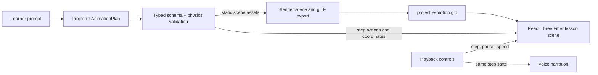

# Gen3D-Edu: first 3D lesson pipeline

## Projectile-motion milestone



Blender authors the reusable static scene assets and exports the binary glTF
`.glb` file. React Three Fiber loads that asset in the browser. The validated
`AnimationPlan` supplies the prompt-specific projectile coordinates, trajectory
parameters, camera, and step sequence; the browser draws the trajectory and
applies each step's `move` action. No generated Blender script or executable
code is accepted from the language model.

## Requirements for the first 3D lesson

- The projectile plan declares `render_mode: "3d"`, scene camera position and
  target, plus geometry, material, position, rotation, scale, and a readable
  label for each visual plan object.
- The validator checks finite coordinates, bounded transforms, positive scale,
  valid material ranges, valid object/action references, and supported geometry
  and action enums.
- The Blender-authored GLB contains reusable scene assets with stable object
  names. In the first scene, the projectile node is named `Projectile`.
- React Three Fiber loads the GLB and reads the current projectile position
  from the structured plan. It draws the prompt-specific trajectory in the
  browser rather than embedding prompt data into arbitrary Blender code.
- Selecting a step applies its actions to the scene. Automatic playback uses
  the selected speed; pausing stops automatic step progression and pauses an
  in-progress scene transition. Replay, next/previous, direct step selection,
  and narration share the same current step.
- Existing lessons with no `render_mode` remain 2D by default. New 3D topic
  renderers are added only after the projectile lesson is validated end to end.

## Blender asset generation

With Blender 4.2 or newer installed, run from the repository root:

```powershell
blender --background --python backend/scripts/create_projectile_scene.py
```

The script writes `frontend/public/scenes/projectile-motion.glb`. The frontend
loads that file at `/scenes/projectile-motion.glb`.
